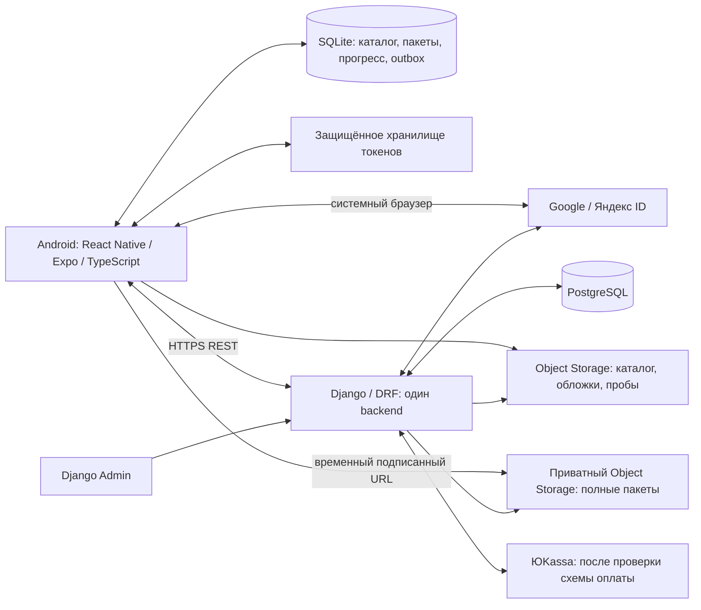

# Storylex: архитектура на согласование

Дата: 10.11.2026. Статус: **архитектурная основа согласована владельцем; этап 1.1 реализован и проверен. Продолжение требует отдельного разрешения**.

Документ основан на полностью прочитанных [ТЗ v1.0](requirements.md) и [стартовом задании](agent-kickoff.md). Владелец согласовал документацию как основу реализации. Последнее разрешение ограничено фундаментом Django-бэкенда (1.1); рекомендации и явно отложенные продуктовые решения ниже сохраняют свой статус. Реализованный объём и команды — в [README](../README.md); точные версии Python-зависимостей — в `backend/uv.lock`.

Порядок чтения:

1. Этот документ: архитектура и монорепозиторий.
2. [Модель данных](data-model.md): сущности, ограничения и ER-диаграмма.
3. [Учебный JSON и публикация](content-format.md): схема, идентичность, пакеты и обновления.
4. [REST API](api-contracts.md): операции и примеры контрактов.
5. [Синхронизация и SRS](sync-and-srs.md): транзакции, конфликты, интервалы.
6. [Безопасность и риски](security-and-risks.md): авторизация, платежи, неоднозначности ТЗ.
7. [Этапы и вопросы на согласование](implementation-plan.md): первый рабочий сценарий и критерии готовности.

## 1. Карта системы



Backend — один модульный Django-монолит, одна БД, один процесс развёртывания приложения с несколькими HTTP-worker при необходимости. Object Storage служит хранилищем файлов. Микросервисы, брокер сообщений, Redis, Celery, Kubernetes и отдельная CMS для MVP не нужны.

SQLite — постоянная локальная база приложения. Скачанные JSON хранятся в ней как неизменяемые документы по ревизиям с индексами уроков; обложки — файлами в постоянном каталоге приложения, а их метаданные и пути — в SQLite. Не полагаться на системный временный image cache как на единственное место офлайн-хранения.

Сервер отвечает за аккаунты, права, платежи, принятые завершения, словарь, SRS и выпуск контента. Клиент рассчитывает локальную последовательность обычных уроков, проверяет обычные ответы по пакету и сохраняет действия до связи. Проверка SRS и расчёт сроков происходят исключительно на сервере.

## 2. Модули монолита

| Django app | Ответственность | Зависимости |
|---|---|---|
| `accounts` | Пользователь, внешние идентичности, сеансы, устройства, настройки | Не зависит от учебных модулей |
| `content` | Каталог, структура, стабильные ID, черновики, импорт, публикация, файлы | Базовый контентный модуль |
| `commerce` | Entitlement, бесплатное получение, заказы, платежи, возвраты | `accounts`, `content` |
| `learning` | Завершения, личный словарь, SRS и задания повторения | `accounts`, `content`; полное право через `commerce`, пробный SRS по подтверждённому завершению |
| `sync` | Inbox идемпотентности, журнал изменений, курсоры, пакетная доставка команд | Вызывает сервисы `learning`, получает изменения прав/настроек |
| `feedback` | Жалобы и персональные уведомления о публикациях | `accounts`, `content`, `commerce` |

Здесь `learning` включает и словарь, и SRS: их жизненные циклы тесно связаны. Разделять их на приложения сейчас не требуется. `feedback` объединяет две небольшие административные функции, без общей системы тикетов.

Внутри приложения достаточно `models`, `services`, `selectors`, `api`, `admin`, `tests`; дробить на подкаталоги только при росте. Сервисы задают транзакционные границы, selectors содержат повторно используемые запросы. DRF views/serializers валидируют HTTP, не управляют алгоритмом публикации или SRS. Django ORM используется напрямую, без универсального repository, CQRS и отдельного event bus.

Межмодульные операции явные: например, подтверждение платежа вызывает выдачу права и запись изменения sync в одной транзакции. Не использовать цепочки Django signals для критических платежных и синхронизационных переходов. Общий модуль `common` — только действительно общие примитивы, без предметной логики.

## 3. React Native-приложение

Предлагается Expo Router для навигации, четыре основных раздела ТЗ: библиотека, каталог, повторения, настройки. До них — вход и подготовка локальных данных. Экраны произведения, главы/эпизода и урока — вложенные маршруты. UI уроков не зависит от языка интерфейса: упражнения всегда EN↔RU.

| Слой | Содержимое |
|---|---|
| Маршруты и экраны | Навигация, состояния загрузки/ошибок, действия пользователя |
| Features | Библиотека, каталог, lesson runner, словарь, SRS, настройки, покупки, жалобы |
| Предметные функции | Порядок уроков, вычисление завершённости, сборка 16 заданий, дополнительная отработка |
| Локальные repositories | SQLite-запросы, транзакции, миграции, чтение пакетов |
| Инфраструктура | HTTP, сессия, sync coordinator, downloader, SecureStore, локальные уведомления |

SQLite хранит подтверждённое состояние и outbox. Экран читает локальное представление «подтверждённое + ожидающие действия». Состояние текущего вопроса, выбранный ответ, перевёрнутая карточка и запрос каталога живут в памяти. Полноценный глобальный state framework не обязателен: начать с React hooks/context и небольших хранилищ по функциям. Не дублировать SQLite целиком в глобальном JS store.

Lesson runner — явный автомат: обычный шаг `question → feedback → next`; последний фактический ответ запускает `local_commit` сразу, до возможности закрыть финальную обратную связь и до итогового экрана. Не ждать нажатия последнего «Продолжить» для сохранения завершения. Для пар есть отдельное состояние сопоставления. Runner закрепляет ревизию при старте, не сохраняет частичную попытку между перезапусками и не выполняет SRS-вызовы. Короткое повторение использует те же компоненты вопросов, но другой сценарий из пяти контекстных заданий.

Порядок разблокировки строится по актуальному списку уроков и множеству завершений. Покупка и последовательность — разные ограничения: замок означает отсутствие права, нейтральная карточка без замка — более поздний урок. Повторно проходить завершённые позже главы после добавления ранних уроков не требуется.

Каталог индексируется локально по названиям ru/en и обоим именам автора `Author.name_ru/name_en`, независимо от текущего языка интерфейса; достаточно нормализованных колонок и SQLite-запросов. У книги — FK на Author. Авторы книжной серии выводятся из её опубликованных книг, её год — минимальный год выхода этих книг; отдельного редактируемого автора/года серии нет. Группировка серии/сериала и поиск отдельных книг/сезонов — разные проекции одних данных. Обложка родителя вычисляется по порядку первой опубликованной дочерней единицы. Нет отдельного родительского прогресса.

Публичный каталог — неизменяемый снимок `CatalogRevision`. Сначала готовится и проверяется файл, затем одна транзакция PostgreSQL активирует его вместе с соответствующими публичными ревизиями материалов. `/catalog/head` читает только активный указатель `CatalogHead`; ожидающие подготовки данные не объявляются опубликованными. Детальный протокол и обработка сбоев — в [публикации](content-format.md).

`Entitlement` — одно основание полного доступа, а не единственная строка на user/Product. Несколько оснований агрегируются в одно право и одну запись библиотеки; возврат отзывает только основание соответствующего заказа. Слова завершённых пробных уроков можно сохранять и повторять через онлайн-SRS без полного права; проба по-прежнему не добавляет произведение в библиотеку. Формула визуального прогресс-бара отложена до реализации lesson runner, требования отсутствия отката и 100% только в конце сохраняются.

UI сразу учитывает увеличение шрифта, полные многострочные варианты и названия, вертикальную прокрутку, светлую/тёмную тему. Список и сетка пути следуют ТЗ; анимация переворота не должна мешать доступности и скорости.

## 4. Предлагаемая структура монорепозитория

Это целевая структура. На этапе 1.1 созданы только backend с apps accounts/content и минимальный infra/compose.yaml; остальные части не создаются заранее.

```text
storylex/
  docs/
    requirements.md
    agent-kickoff.md
    architecture.md
    data-model.md
    content-format.md
    api-contracts.md
    sync-and-srs.md
    security-and-risks.md
    implementation-plan.md
  backend/
    pyproject.toml
    uv.lock
    manage.py
    config/                 # settings: base/dev/test/prod; URLs, WSGI
    apps/
      accounts/
      content/
      commerce/
      learning/
      sync/
      feedback/
    common/
    tests/                  # только межмодульные сценарии
  mobile/
    package.json
    package-lock.json
    app.config.ts
    app/                    # Expo Router; тонкие файлы маршрутов
    src/
      features/
      domain/
      data/                 # SQLite repositories, migrations
      infrastructure/       # api, auth, sync, downloads, notifications
      ui/
      i18n/
    assets/                 # UI-ресурсы, не весь каталог произведений
  contracts/
    content/v1/             # JSON Schema после согласования
    openapi/                # экспорт DRF OpenAPI
    fixtures/               # безопасные примеры для обеих сторон
  infra/
    compose.yaml
    backend.Dockerfile
    proxy/                  # production HTTPS/reverse proxy
  .env.example
  README.md
```

Один репозиторий позволяет менять формат пакета, сервер и клиент одним логическим изменением. Python-зависимости изолированы в `backend`, JS — в `mobile`; общий workspace-оркестратор и monorepo framework не нужны. Предлагается npm с одним lockfile для единственного клиента; `uv` и `uv.lock` — для backend. Версии выбираются при разрешённой реализации и фиксируются lockfile, а не словом `latest` в сборке.

Контракт JSON — источник формальной структуры; примеры и негативные fixtures проверяют одинаковое понимание на сервере и клиенте. OpenAPI описывает REST. Генерацию TypeScript-клиента можно подключить, когда API стабилизируется; общую Python/TS библиотеку предметной логики не создавать.

Исходные редакционные JSON хранятся приватно и резервируются; не публиковать весь платный учебный корпус в общедоступном Git-репозитории. В `contracts/fixtures` — только разрешённые примеры. Текущий `.gitignore` оставляется без изменений; будущие локальные БД, скачанные пакеты, credentials и сборочные артефакты проверяются перед добавлением новых файлов.

## 5. Запуск, фоновые операции и эксплуатация

На этапе 1.1 локальный Docker Compose запускает только PostgreSQL, Django работает в WSL2 через uv и тот же интерпретатор PyCharm. Контейнер приложения можно добавить при подготовке развёртывания; это по-прежнему один монолит. Мобильный Metro/Expo позднее запускается на машине разработчика. Object Storage подключается через настройки: в локальном dev допустим файловый storage с приватной выдачей через Django, в production — два раздельных публичный/приватный пространства. MinIO не обязателен для первого сценария.

Импорт и публикация небольшого материала сначала синхронны в Admin с ограничением размера. Для восстановления платежей и уведомлений достаточно повторяемых management commands по системному расписанию. Публикации имеют отметку обработки; пропущенную работу можно безопасно повторить. Необходимость отдельного worker оценивается по реальному времени операций, без ввода очереди заранее.

Production требует доступного HTTPS-домена, PostgreSQL, постоянного storage, резервного копирования и секретов вне Git. Планировщик — обычный cron/systemd timer вне HTTP-worker. Для SRS ежедневный scheduler не нужен: сроки уже записаны, очередь выбирается по `next_review_at <= now()`.

Триггеры клиентской синхронизации: запуск, восстановление соединения, значимые изменения, ручное действие; проверка каталога при возвращении из фона, если прошло более часа. ОС может остановить приложение: немедленную синхронизацию в фоне не обещаем, очередь надёжно ждёт следующего запуска.

## 6. Минимальный первый результат

Одна настоящая глава с одним или несколькими уроками проходит путь: исходный JSON → Admin → валидация → ручная публикация → защищённая/пробная доставка → SQLite → пять единиц и 16 заданий → транзакция завершения и outbox → серверное подтверждение. На этом шаге разрешены только изолированные dev-заглушки входа/прав. Подробный план и граница публичного выпуска — в [этапах реализации](implementation-plan.md).
