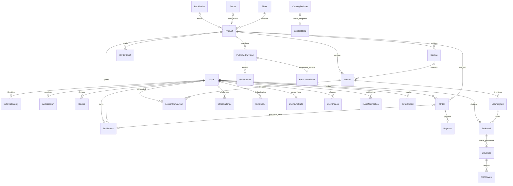

# Storylex: модель данных

Статус: модель согласована как основа; реализован только этап 1.1. Таблицы ниже описывают целевую модель, а не полный перечень уже созданных таблиц. Контекст — [архитектура](architecture.md).

### Реализованный объём 1.1

Созданы User, Author, BookSeries, Show, Product, Section и заготовка ContentDraft.
UUID — первичные ключи всех этих сущностей. У User сохранён необязательный
уникальный `username` только для staff-входа в Admin; email nullable и неуникальный,
у обычного `create_user()` пароль неиспользуемый. Собственного парольного API нет.

Product/Section пока содержат только редакционные данные. Указатели/даты
публикации, availability и Asset будут добавлены вместе с соответствующими
операциями; никаких публичных снимков сейчас нет. Реестр Lesson/LearningItem
отложен до кода, который обслуживает его при публикации в 1.2.
ContentDraft хранит исходный JSON, но пока не имеет импорта/редактирования через
Admin; пустой hash и NULL validation_version явно означают отсутствие валидации.
Проверки Product в одной строке, уникальности и диапазоны защищены БД;
соответствие Section.kind типу Product и запрет переноса стабильной секции —
`clean()` и транзакционными сервисами, которые вызывает Admin.
Обычный ORM `save()`/`update()` не заменяет эти сервисы. Остальные сущности ниже
не создаются до разрешения соответствующих этапов.

## 1. Основной выбор

Использовать общую сущность `Product` для приобретаемой книги, сезона или фильма. `Section` — глава книги или эпизод сезона. Это не произвольное дерево контента: допустимы только три строго определённых типа и две разновидности секций. Серия книг и сериал остаются отдельными моделями.

Так `Entitlement`, `Order`, `Lesson` имеют обычный FK на одну приобретаемую единицу, без `GenericForeignKey`, трёх nullable FK и сложного полиморфного наследования. Предметные Book/Season/Movie и Chapter/Episode представлены типизированными строками; в Admin у них отдельные формы/фильтры. Отдельные таблицы подтипа пока не дают полезных дополнительных связей.

Реляционно хранятся идентичность, структура, доступ и пользовательское состояние. Полные предложения, дистракторы и примеры — в JSON черновика и опубликованной ревизии. `Exercise` и `AnswerOption` не становятся SQL-моделями, но имеют стабильные ID внутри JSON и доступны для жалоб/SRS по ревизии.

## 2. Аккаунты

| Модель | Ключевые поля и связи | Ограничения |
|---|---|---|
| `User` | UUID PK; email nullable; active, created_at | Кастомная модель с начала проекта; пользовательский пароль не используется; email не идентификатор объединения |
| `ExternalIdentity` | user FK; provider; subject; email nullable; email_verified nullable | UNIQUE(provider, subject); для MVP UNIQUE(user, provider); subject берётся из проверенного ответа провайдера |
| `AuthSession` | UUID; user FK; device FK; хеш refresh token; expires_at, revoked_at; сведения о ротации | Сырые refresh tokens не хранить; отзыв и повторное использование контролируются сервером |
| `AuthAttempt` | provider, state hash, nonce/PKCE-связка где применимо, purpose, target_user nullable, expires_at, consumed_at | Одноразовый контекст входа/привязки, короткий TTL |
| `Device` | UUID; user FK; created_at, last_seen_at | ID не является средством авторизации; клиентский sequence относится к этой регистрации устройства |
| `UserSettings` | OneToOne user; UI locale, theme, sound, haptics, library_group_order, analytics choice | Locale ru/en; порядок групп — перестановка books/shows/movies |

Настройка напоминания и системное разрешение принадлежат установке устройства: локальная SQLite хранит время, часовой пояс, статус объясняющего диалога и разрешения. Сервер не может включить разрешение на другом телефоне. Настройки аккаунта при одновременном изменении используют ревизию, как обычный небольшой документ, а не механизм конфликтов словаря.

## 3. Каталог и контент

| Модель | Поля/связи | Ключевые правила |
|---|---|---|
| `BookSeries` | UUID; title_ru/en, description_ru/en, order | Видимость только при опубликованном ребёнке; обложка вычисляется |
| `Author` | UUID; name_ru, name_en | Оба имени непустые; одна сущность автора для книг, имя не UNIQUE |
| `Show` | UUID; title_ru/en, description_ru/en, release_year | Аналогично серии; покупается сезон, не сериал |
| `Product` | UUID; kind book/season/movie; book_series FK nullable; show FK nullable; sequence nullable; author FK nullable; year; title/description ru/en; cefr_min/max; access_mode paid/free; price_minor; currency RUB; trial_enabled; current_revision FK nullable; availability; first_published_at | Author обязателен только книге; year обязателен и означает год выхода конкретной книги/сезона/фильма; цена в копейках, не float |
| `Section` | UUID; product FK; kind chapter/episode; position; title_ru/en; retired_at nullable | У фильма секций нет; опубликованная структура читается из ревизии |
| `Lesson` | UUID; product FK; section FK nullable; position; retired_at nullable | У фильма section NULL; у книги/сезона обязателен; ID сохраняется при правке |
| `LearningItem` | UUID; product FK; lesson FK; position 1–5; sense_key; базовые en/ru для индексирования; retired_at nullable | UNIQUE(product, sense_key); identity одного значения в пределах Product, не глобальный словарь |
| `ContentDraft` | UUID; product FK; section FK nullable; JSONField исходного документа; source_hash; validation_version; updated_at | Один текущий черновик на главу/эпизод либо весь фильм; исправления не меняют published snapshot |
| `PublishedRevision` | UUID; product FK; number; schema_version; immutable full/trial manifests JSON; publication_kind initial/correction/extension; published_at | UNIQUE(product, number); полный снимок единицы; trial manifest сохраняет точный публичный состав этой ревизии |
| `PackArtifact` | UUID; revision FK; scope full/trial; section FK nullable; object_key; SHA-256; byte_size; schema_version | Immutable; входит в manifest; одна строка на доставляемый JSON-документ |
| `Asset` | UUID; storage key; checksum, byte_size, media_type, width/height | Для обложек 2:3; отсутствие допустимо; asset переиспользуется по хешу |
| `CatalogRevision` | UUID; immutable snapshot JSON; schema_version; object_key; sha256; byte_size; activated_at | Снимок каталога в БД и файл содержат одинаковые данные и catalog_revision; создаётся при активации уже подготовленного файла |
| `CatalogHead` | Единственная строка; current_revision FK на CatalogRevision nullable; source_revision bigint | Публичный указатель и счётчик изменений исходных данных; переключение только после готовности файла |

`Product` дополнительно ссылается на обложку `Asset`. Количества уроков, единиц и секций вычисляются при публикации и записываются в manifest; API не пересчитывает содержимое файлов на каждый запрос.

Поля Admin являются редактируемым проектом структуры и метаданных. Публичные каталожные поля, включая цену, режим free/paid, пробу и ссылки на учебные ревизии, читаются из **активного CatalogRevision**, не из изменяемых форм Admin. При публикации материала Product.current_revision и CatalogHead переключаются одной транзакцией. Изменения цены, автора, серии/сериала тоже выпускают новый снимок каталога, но не требуют новой ревизии упражнений. Исключительная availability-блокировка проверяется отдельно немедленно на сервере и затем отражается в следующем каталоге. Заказы/claim-free перепроверяют актуальный активный снимок, а не устаревшие данные клиента.

У BookSeries нет собственного редактируемого года или FK автора. В пределах одного CatalogRevision её `authors` — уникальные Author опубликованных книг, `year` — минимум их `Product.year`; неопубликованные книги не участвуют. Для общего автора отображается одно имя, для разных — список имён без выдуманного единого автора. Это год самого раннего из **опубликованных в приложении** томов, не год создания серии; при добавлении более раннего тома он может измениться. Обложка по-прежнему берётся у первой опубликованной книги **по порядку серии**, а не обязательно по минимальному году.

В снимке у книги передаётся автор `{id, name_ru, name_en}`, у серии — производные authors/year. В SQLite индексируются оба имени каждого автора вместе с названиями ru/en; запрос ищет в обоих языках независимо от локали, в том числе отдельные книги внутри серии. Для небольшого каталога достаточно Unicode-нормализации NFC, приведения к нижнему регистру и нормализации пробелов с одинаковыми правилами на клиенте и сервере. Отдельные таблицы переводов, псевдонимов и поисковый сервис не требуются. Исправление Author проходит общую публикацию каталога и не меняет стабильный author ID.

### Ограничения базы и сервисов

- CHECK Product: book → show NULL, author_id NOT NULL; season → show NOT NULL, book_series NULL, sequence > 0; movie → обе родительские ссылки NULL. У книги серия необязательна; номер обязателен только внутри серии. У остальных типов author_id NULL. Author, используемый книгой, удаляется с PROTECT.
- Условные UNIQUE(book_series, sequence), UNIQUE(show, sequence); CHECK price_minor >= 0, для paid цена > 0; корректный диапазон CEFR по рангу A1…C2.
- UNIQUE(product, position) для секций; условные UNIQUE(section, position) для уроков с секцией и UNIQUE(product, position) для уроков фильма; UNIQUE(lesson, position) для LearningItem.
- Межтабличное соответствие `lesson.product = section.product`, допустимый kind секции, ровно пять единиц и непустой полный состав проверяет транзакционный сервис импорта/публикации. Обычный CHECK БД не проверяет чужие строки, `Model.clean()` сам при `save()` не запускается; Admin и API обязаны вызывать один сервис.
- `current_revision.product = product` тоже проверяется сервисом публикации, с блокировкой Product. Нельзя переключить указатель на чужую ревизию.
- CHECK Bookmark: present требует generation NOT NULL, absent — generation NULL; revision неотрицательна. Соответствие активного SRSState этой generation и принадлежность SRSReview одному user проверяют сервисы под общей транзакционной блокировкой.
- Опубликованные Lesson/LearningItem не удаляются физически и не получают новые ID из-за порядка, исправления перевода или смены номера. FK на контент — PROTECT. Новое значение — новый ID; семантическая подмена запрещена.
- При импорте разрешено подготовить draft JSON с новыми ID; реестр Lesson/LearningItem и опубликованные индексы обновляются только при публикации. Неизвестный ID обязан быть новым во всём реестре, а не коллизией с чужим Product.

Непрерывность позиций и полнота подготовленных глав/эпизодов проверяются при публикации всей продаваемой единицы. Метка «всё подготовлено» — осознанное подтверждение автора состава, не автоматическая догадка о числе глав книги.

## 4. Доступ и коммерция

| Модель | Поля/связи | Ограничения |
|---|---|---|
| `Entitlement` | UUID; user FK; product FK; source purchase/free/dev; granted_at; revoked_at/reason nullable; order OneToOne nullable | Одна строка на основание; общей UNIQUE(user, product) **нет**. UNIQUE(user, product) только WHERE source=free; dev — только в dev-данных |
| `Order` | UUID; user FK; product FK; amount_minor, currency; status; created_at, expires_at; idempotency_key | Условный UNIQUE(user, product) для creating/pending; снимок цены; UNIQUE(user, idempotency_key) |
| `Payment` | UUID; order OneToOne; provider; provider_payment_id nullable; creation_key; status; checked_at | UNIQUE(provider, provider_payment_id), UNIQUE(creation_key); один платёж на заказ MVP |
| `PaymentNotification` | provider; dedupe_key; payment reference; processing status, attempts | Уникальный ключ доставки/канонического события; минимальное проверенное содержимое, без карточных данных |
| `Refund` | payment FK; provider_refund_id; amount_minor; status; reason | UNIQUE(provider_refund_id); нужна для серверного учёта, не пользовательский раздел истории |

`source=purchase` требует order NOT NULL, остальные источники — order NULL; соответствие user/Product заказу проверяет сервис. UNIQUE(order) даёт не более одного основания на проверенную покупку и не мешает новому заказу после возврата. Бесплатное основание одно на пару user/Product, бессрочное; переход free→paid его не меняет. Исключительный юридический отзыв не отменяется повторным claim-free автоматически.

**Итоговое полное право** вычисляется через EXISTS действующего Entitlement для user/Product; отдельно проверяется глобальная availability. Отдельной агрегирующей таблицы/счётчика активных оснований не нужно. В API, SQLite и UserChange — одна агрегированная запись с ключом product_id: `has_full_access`, `granted_at` (самое раннее действующее основание, null если их нет), `revision` из последнего UserChange этого агрегата. Availability относится к каталогу/немедленному серверному запрету, а не к персональной ревизии права. История источников остаётся на сервере, несколько оснований не дублируют библиотеку. При изменении основания агрегат пересчитывается и записывается в sync в той же транзакции под UserSyncState; даже если has_full_access осталось true, его revision возрастает.

Полный подтверждённый возврат (в том числе сумма нескольких успешных частичных возвратов, достигшая суммы платежа) отзывает **только** основание с order этого платежа. Если есть free или другое действующее основание, полное право остаётся. Возвраты до полной суммы сами по себе не отзывают основание; поведение в юридических исключениях согласуется отдельно. Повторный webhook не создаёт основание и не снимает revoke. Заказы refunded не переходят обратно в succeeded по запоздавшему сообщению.

Повторный запрос возвращает существующий незавершённый заказ. Новый заказ после неудачи создаётся лишь после проверки терминального состояния предыдущего платежа. Нельзя «истечь» локальный заказ и забыть возможную позднюю успешную оплату. Получение free и успешный ранее созданный платёж могут дать два независимых основания: оба сохраняются. Наличие полного права запрещает создание новой покупки, но не стирает факт уже состоявшегося платежа. Переходы и возвраты — в [безопасности](security-and-risks.md).

## 5. Учебное состояние и sync

| Модель | Поля/связи | Ограничения |
|---|---|---|
| `LessonCompletion` | user FK; lesson FK; first_revision FK; trial_revision FK nullable; client_completed_at; accepted_at | UNIQUE(user, lesson); завершение монотонно; trial_revision — сохранённая сервером ревизия, в trial manifest которой входил урок |
| `Bookmark` | UUID; user FK; item FK; present bool; revision bigint; generation UUID nullable; changed_at | UNIQUE(user, item); удалённая строка остаётся tombstone; новая generation только при absent→present |
| `SRSState` | bookmark OneToOne; generation; level 1…8; next_review_at; revision; last_review_at nullable; has_history | Только для present; индекс next_review_at; одна активная история на generation |
| `SRSChallenge` | UUID; user FK; bookmark/generation; state_revision; revision контента; exercise_id; вопрос/варианты и ключ ответа; expires_at; consumed/invalidated_at | Одноразовый серверный вопрос; сохраняет снимок, перестановку и уже принятый ответ до TTL |
| `SRSReview` | UUID ответа; user FK; state FK; challenge OneToOne; result, previous/new level, reviewed_at | UNIQUE(user, answer_id); удаляется при подтверждённом сбросе слова; challenge не может изменить состояние дважды |
| `SyncInbox` | user FK; operation_id UUID; device FK; sequence; type; payload_hash; итог обработки | UNIQUE(user, operation_id), UNIQUE(device, sequence); ответ фиксируется атомарно с изменением |
| `UserSyncState` | user OneToOne; last_revision bigint | Блокировка строки задаёт порядок пользовательских изменений |
| `UserChange` | user FK; revision; entity_type/id; immutable payload или invalidation | UNIQUE(user, revision); индекс(user, revision); revision выдаётся внутри той же транзакции под блокировкой |

Не хранить отдельные пользовательские `ChapterCompletion`/`ProductCompletion`: текущая завершённость вычисляется по множеству обязательных lesson_id опубликованного состава. Это предотвращает рассинхронизацию трёх уровней прогресса. `last_learning_action_at` — производный максимум времени завершений, а не времени простого открытия карточки. Короткие повторения не записывают LessonCompletion/SRSReview.

Для слов **завершённой бесплатной пробы** достаточно подтверждённого LessonCompletion.trial_revision: full Entitlement не нужен ни для добавления закладки, ни для онлайн-SRS. Trial_revision выставляется только после серверной проверки membership урока в immutable trial manifest указанной ревизии; клиентский флаг trial не является основанием. При завершении уже пройденного урока trial_revision можно заполнить, если он позднее стал пробным, без второго завершения/сброса прогресса. Поле не перезаписывается платным прохождением и не очищается при отключении новых проб или возврате оплаты. SRS без полного права использует только вопросы сохранённого пробного снимка. Это не полное право, не библиотечная запись и не подписка на новинки; глобальная юридическая блокировка всё равно действует.

Пользовательские FK на аккаунт обычно CASCADE при удалении аккаунта. Финансовые строки имеют отдельно согласованную политику обезличивания/retention. Удаление Bookmark логическое, SRSState и SRSReview удаляются физически при подтверждённом сбросе; challenge инвалидируются. Tombstone и минимальная квитанция sync не восстанавливают удалённую историю. Старые публичные файлы сохраняются технически, без Admin UI отката.

## 6. Жалобы и уведомления

| Модель | Состав |
|---|---|
| `ErrorReport` | UUID клиента (дедупликация на аккаунт); user; product/revision/lesson/item/exercise IDs; тип сценария normal/short/srs; comment; status new/resolved; серверный снимок контекста |
| `PublicationEvent` | revision OneToOne; тип initial/extension; added_product/lesson IDs; occurred_at; processing cursor/status |
| `InAppNotification` | user; publication_event; target IDs; компактный payload; read_at nullable; UNIQUE(user, publication_event) |

Сервис записывает PublicationEvent транзакционно с **активацией каталога**, occurred_at — это время активации, не загрузки файла. Повторяемая команда формирует уведомления по действующим полным основаниям с granted_at **до occurred_at**: о новой книге знакомой серии, сезоне знакомого сериала, новых уроках доступной единицы. Несколько оснований не дублируют уведомления; одной пробы недостаточно. Исправление опечатки не новинка. Для MVP одно событие — одно уведомление; объединение нескольких книг допустимо, но не обязательно. Прочтение фиксируется по серверному курсору списка, чтобы не отметить будущие уведомления.

## 7. ER-диаграмма ключевых связей

Диаграмма показывает связи; ограничения количества «пять», принадлежности и состояния перечислены отдельно, а не выражены одной кардинальностью Mermaid.
